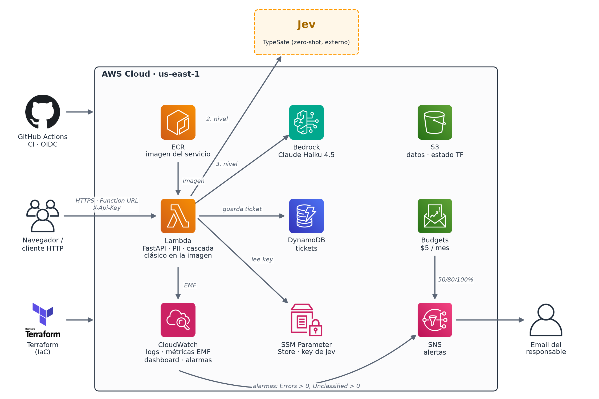

# Ticket Triage

Clasificación de tickets de soporte por **categoría** (8 equipos) y **prioridad** (`urgent` / `not_urgent`) con una **cascada de costo mínimo**: modelo clásico → Jev (TypeSafe, zero-shot) → Claude Haiku 4.5 en Amazon Bedrock. La PII se redacta antes de clasificar y guardar.

Proyecto final de MLOps (AWS + ML). Datos: CFPB Consumer Complaint Database, Narratives Archive (dominio público).

- Arquitectura detallada: [docs/architecture.md](docs/architecture.md)
- Reporte: `docs/report/reporte-final.md` (PDF con `./scripts/build_report.sh`)
- Resultados: [reports/benchmark.md](reports/benchmark.md), [reports/fairness.md](reports/fairness.md)

## Resultados

Categoría, prueba temporal (n = 1,000):

| Modelo | macro-F1 [IC 95%] | p95 ms | USD / 1k tickets |
|---|---|---|---|
| Clásico (TF-IDF + LinearSVC calibrado) | 0.741 [0.712, 0.768] | 6 | 0.000 |
| Jev | 0.737 [0.709, 0.762] | 164 | 0.060 |
| Claude Haiku 4.5 | 0.745 [0.716, 0.770] | 741 | 0.946 |
| **Cascada** | **0.762 [0.732, 0.787]** | 155 | **0.048** |

- La cascada es mejor que cada modelo solo y cuesta ~20 veces menos que usar Claude para todo. El clásico resuelve el 89% de los tickets.
- En prioridad, la cascada alcanza recall de `urgent` 0.963 en validación. Usa umbrales asimétricos: `not_urgent` exige confianza ≥ 0.9.
- Equidad: por tag (*Older American*, *Servicemember*) la brecha en prueba es 0.017. La mayor brecha es por **longitud del texto**: 0.149 entre los textos más cortos y los más largos. Detalle y limitaciones en el reporte.

## Arquitectura desplegada



Servicios AWS: Lambda, ECR, DynamoDB, Bedrock, CloudWatch, SNS, SSM Parameter Store, S3, IAM (OIDC para GitHub Actions), Budgets y SES. Todo en Terraform (`infra/`).

## API

| Ruta | Descripción |
|---|---|
| `GET /` | Página web de inferencia |
| `POST /v1/tickets` | `{"subject": "...", "body": "..."}` → ticket clasificado (`201`) |
| `GET /v1/tickets?limit=50` | Tickets más recientes |
| `GET /v1/tickets/{id}` | Un ticket |
| `GET /docs` | OpenAPI / Swagger |

```bash
curl -X POST "$API_URL/v1/tickets" -H "X-Api-Key: $TRIAGE_API_KEY" \
  -H "Content-Type: application/json" \
  -d '{"subject": "Card stolen", "body": "Someone used my credit card for purchases I did not make."}'
```

Por tarea, la respuesta trae etiqueta, confianza, nivel de la cascada (`classic` | `jev` | `claude` | `none`), versión del modelo, latencia, costo y niveles omitidos. Si todos los niveles fallan, el ticket se guarda como "sin clasificar" (`none`).

## Estructura

```
backend/triage_core/   librería pura: etiquetas, clasificadores, cascada, calibración, PII, ids
backend/services/      servicio de inferencia (FastAPI) y handler de Lambda
training/              datos, entrenamiento, evaluación, umbrales, benchmark, equidad
infra/                 Terraform (bootstrap del estado + stack principal)
docker/                imagen de Lambda
notebooks/ labeling/   EDA y etiquetado del golden set (Label Studio)
datasets/ reports/     etiquetas, golden set, resultados
```

## Uso local

```bash
cp .env.example .env   # llenar valores; nunca commitear .env
make setup
make test              # 197 tests, sin costo (APIs y AWS simulados)
make lint
```

## Entrenamiento y evaluación

Los targets marcados `[$]` llaman APIs pagadas (Claude en Bedrock, Jev): imprimen el costo estimado y piden confirmación. Las predicciones se guardan en caché, así que repetir un target no vuelve a pagar.

```bash
make data splits                   # datos CFPB y splits temporales
make smoke-claude kappa-gate       # [$] acceso a Claude y acuerdo con el golden set
make distill train                 # [$] etiquetas de prioridad (destilación) y entrenamiento
make eval-sets predict             # [$] predicciones de clásico, Jev y Claude
make thresholds benchmark fairness # umbrales de la cascada, benchmark y equidad
```

## Despliegue

Requisitos: la API key del tenant demo en `.env` como `TRIAGE_API_KEY` y la key de Jev en SSM (`/ticket-triage/typesafe-api-key`, SecureString).

```bash
make whoami        # confirmar la cuenta AWS
make api-deploy    # [$] imagen → ECR → Lambda + Function URL (centavos)
make smoke-api     # [$] 3 tickets contra la API desplegada
```

## CI

GitHub Actions en cada PR: `ruff` (lint, formato y reglas de seguridad), `pytest` con cobertura, `terraform fmt`/`validate` y Trivy sobre la configuración IaC.

## Costos

Presupuesto total < $10 USD. Sin endpoints de SageMaker, NAT Gateway ni servicios con costo fijo. AWS Budgets alerta al 50, 80 y 100% de $5 al mes.

## Datos y ética

La CFPB dejó de publicar narrativas el 2026-08-14; el archivo conserva las publicadas antes, con consentimiento del consumidor. Los tags *Older American* y *Servicemember* se usan solo para medir equidad, nunca como features. El análisis ético completo (grupos afectados, riesgos, mitigaciones y limitaciones) está en el reporte.
