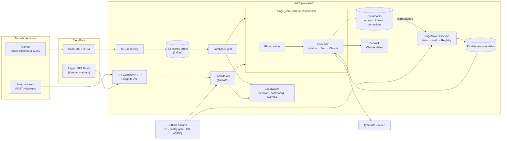

# Arquitectura

Ticket Triage es un SaaS multi-tenant que clasifica tickets de soporte (correo y API) por **categoría** y **prioridad**, y los rutea a un tablero Kanban. La clasificación usa una **cascada de costo**: primero un modelo clásico propio del tenant; si no tiene confianza suficiente, Jev (modelo de decisión zero-shot de TypeSafe); y como último nivel Claude en Amazon Bedrock, que además explica la decisión.

## Diagrama

## Flujo de un ticket

1. Llega un correo a `<tenant>@tickets.luisv.dev` (o un `POST /v1/tickets` con la API key del tenant).
2. SES guarda el correo crudo en S3 y dispara la Lambda de ingesta.
3. `triage_core` redacta datos personales (PII) y corre la cascada: el modelo clásico del tenant responde si su confianza supera el umbral; si no, Jev; si tampoco, Claude, que además devuelve una explicación.
4. El ticket clasificado se guarda en DynamoDB y aparece en la columna de su equipo en el Kanban.
5. Si un agente lo arrastra a otra columna o cambia la prioridad, la corrección se guarda y alimenta el siguiente reentrenamiento.

## Decisiones clave

| Decisión | Motivo |
|---|---|
| Modelo clásico dentro de Lambda (no endpoint de SageMaker) | Un endpoint real-time cobra 24/7; Lambda cobra por uso y cabe en el presupuesto (< $10 USD) |
| `triage_core` sin dependencias de AWS | El mismo código corre en entrenamiento, serving y tests: sin *training-serving skew* |
| Cascada de 3 niveles | La mayoría de los tickets los resuelve un modelo de fracción de centavo; el LLM solo ve los difíciles |
| PII redaction antes de Jev/Claude | Ningún dato personal sale a APIs externas |
| Terraform + GitHub OIDC | Toda la infraestructura es código y CI/CD no usa access keys |
