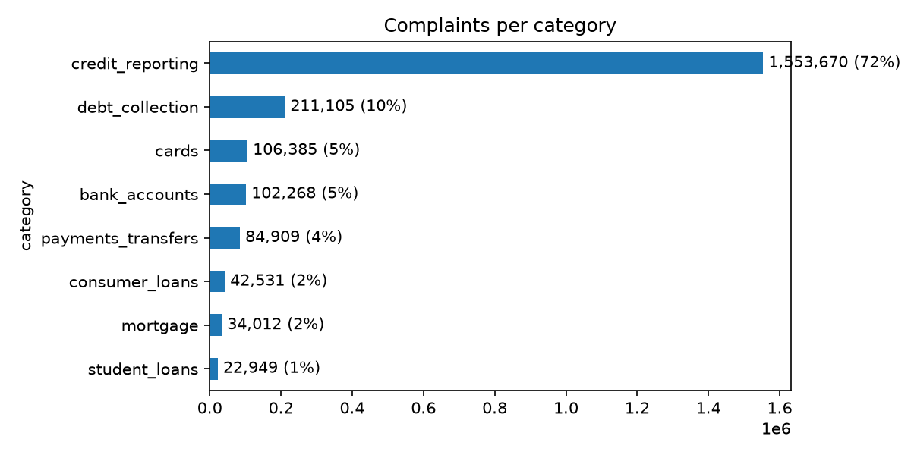
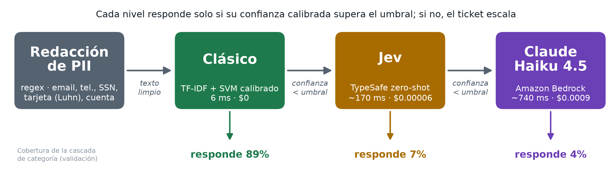
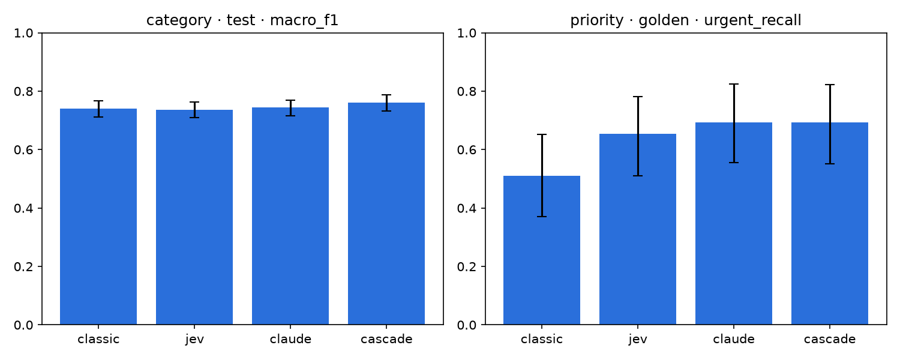
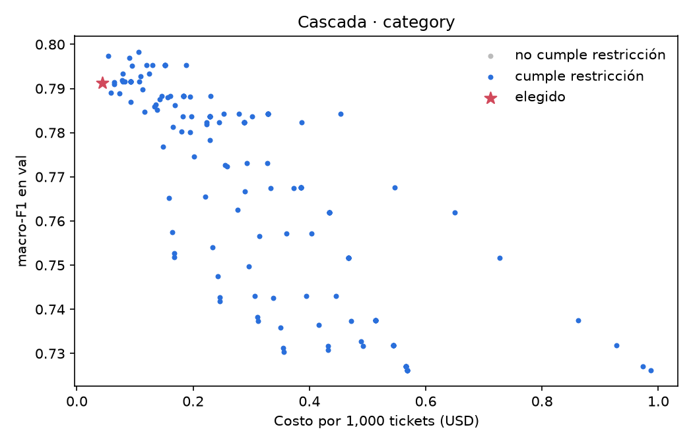
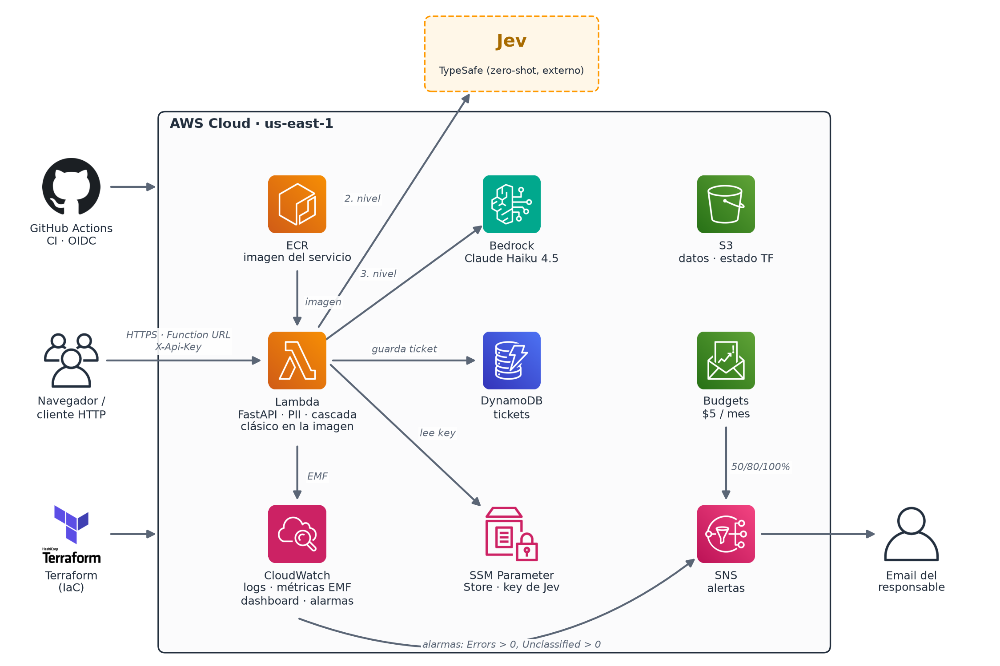
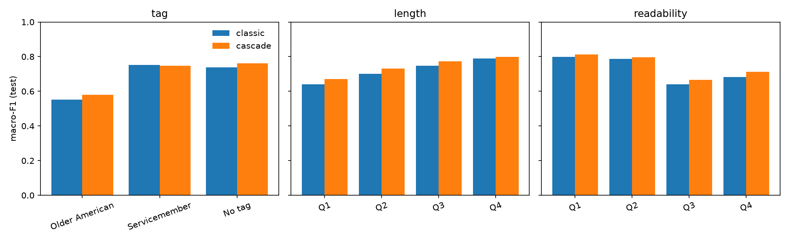

# Resumen

Ticket Triage clasifica quejas de clientes de servicios financieros por **categoría** (8 equipos de soporte) y **prioridad** (`urgent` / `not_urgent`). Usa una **cascada de costo**: un modelo clásico (TF-IDF + SVM calibrado) responde cuando tiene confianza; si no, el ticket escala a **Jev** (TypeSafe, zero-shot) y, como último nivel, a **Claude Haiku 4.5** en Amazon Bedrock. Antes de clasificar y guardar, el texto pasa por una **redacción de PII**. El servicio corre en **AWS Lambda** (imagen de contenedor en ECR) con una **página web de inferencia** y una API REST, guarda los tickets en **DynamoDB** y publica métricas y alarmas en **CloudWatch**.

En el set de prueba temporal (n = 1,000), la cascada de categoría obtiene **macro-F1 0.762**, por encima del clásico (0.741), Jev (0.737) y Claude (0.745), a **$0.048 por cada 1,000 tickets** contra $0.946 de usar solo Claude (**~20 veces menos**). La cascada de prioridad alcanza **recall de `urgent` 0.963** en validación. La equidad se midió por grupo (*Older American*, *Servicemember*, longitud y legibilidad del texto) con intervalos bootstrap.

# 1. Problema y datos

## 1.1 Problema

Los equipos de soporte reciben tickets por correo y API sin clasificar. Un agente lee cada uno para decidir a qué área va y qué tan urgente es. El proceso es lento y no es consistente, y retrasa justo los casos que no pueden esperar: fraude, dinero retenido, ejecución hipotecaria.

## 1.2 Por qué ML

El texto es libre y variable, y las reglas por palabras clave no cubren redacciones nuevas. Un clasificador de texto aprende del lenguaje real, entrega una **confianza calibrada** por predicción (lo que permite decidir cuándo escalar a un modelo más caro) y se puede reentrenar. Los LLM aportan zero-shot para casos difíciles y para tenants nuevos sin datos, pero cuestan por llamada. La cascada combina lo mejor de ambos.

## 1.3 Dataset

**CFPB Consumer Complaint Database, Narratives Archive** (dominio público): quejas con narrativa de 2024-01 a 2026-08, en inglés. La CFPB dejó de publicar narrativas el 14 de agosto de 2026; el archivo conserva las publicadas antes, todas con consentimiento del consumidor.

- **Categoría:** los productos CFPB se mapean a 8 categorías (`datasets/categories_v1.json`): cobranza, cuentas bancarias, tarjetas, pagos y transferencias, hipotecas, préstamos estudiantiles, préstamos de consumo y reportes de crédito.
- **Prioridad:** binaria. `urgent` significa daño activo o inminente (fraude en curso, dinero retenido, remate, amenaza legal, acoso). La CFPB no trae prioridad: se **destiló** de etiquetas de Claude sobre 2,000 tickets (1,600 de entrenamiento y 400 de validación).
- **Golden set:** 100 tickets etiquetados a mano en Label Studio. Es la única verdad humana y se usa para evaluar y para el gate de equidad.
- **Splits temporales:** entrenamiento con meses antiguos; validación y prueba con meses recientes (holdout temporal, sin fuga hacia el golden).
- La columna `Tags` (*Older American*, *Servicemember*) se conserva **solo para medir equidad**, nunca como feature.
- Desbalance de clases: se trata con *class weights* y la métrica principal es macro-F1.

{width=75%}

El EDA (`notebooks/01_eda.py`) incluye además la longitud de las narrativas, el volumen por mes y los tags por categoría (`docs/figures/eda_*.png`).

# 2. Modelos y selección

## 2.1 Modelos comparados

| Modelo | Tipo | Entrenamiento | Costo por ticket |
|---|---|---|---|
| Baseline TF-IDF + Logistic Regression | Clásico | 150k filas | ~0 |
| **Clásico** TF-IDF (hashing) + LinearSVC calibrado | Clásico | 50k (categoría), 1.6k (prioridad) | ~0 |
| **Jev** (TypeSafe System One) | Zero-shot, probabilidades | ninguno | $0.00006 |
| **Claude Haiku 4.5** (Bedrock, salida estructurada) | LLM zero-shot | ninguno | ~$0.0009 |
| **Cascada** clásico → Jev → Claude | Combinado | umbrales en val | ponderado |

{width=100%}

El clásico se eligió entre regresión logística y LinearSVC por macro-F1 en validación, con calibración isotónica (categoría) o sigmoide (prioridad) para que la confianza sea confiable (ECE 0.041 en prueba). A Jev se le ajustó una temperatura (T = 4.0 en categoría) porque estaba sobreconfiado (ECE 0.195).

## 2.2 Resultados (benchmark con IC 95% por bootstrap)

**Categoría, prueba temporal (n = 1,000)**

| Modelo | macro-F1 [IC 95%] | Accuracy | ECE | p95 ms | USD / 1k |
|---|---|---|---|---|---|
| Clásico | 0.741 [0.712, 0.768] | 0.745 | 0.041 | 6 | 0.000 |
| Jev | 0.737 [0.709, 0.762] | 0.706 | 0.206 | 164 | 0.060 |
| Claude | 0.745 [0.716, 0.770] | 0.716 | 0.284 | 741 | 0.946 |
| **Cascada** | **0.762 [0.732, 0.787]** | **0.761** | 0.063 | 155 | **0.048** |

**Prioridad, validación (n = 400)**

| Modelo | macro-F1 | Recall `urgent` [IC 95%] | p95 ms | USD / 1k |
|---|---|---|---|---|
| Clásico | 0.726 | 0.580 [0.503, 0.651] | 4 | 0.000 |
| Jev | 0.826 | 0.753 [0.681, 0.815] | 181 | 0.060 |
| **Cascada** | **0.866** | **0.963 [0.931, 0.988]** | 897 | 0.166 |

En prioridad, Claude obtiene 1.0 en validación **por construcción**: las etiquetas de validación son de Claude. Por eso esa fila no se usa para comparar (ver limitaciones).

**Golden set humano (n = 100)**

| Modelo | Categoría macro-F1 | Prioridad macro-F1 | Recall `urgent` |
|---|---|---|---|
| Clásico | 0.623 | 0.660 | 0.510 |
| Jev | 0.753 | 0.718 | 0.653 |
| Claude | 0.743 | 0.768 | 0.694 |
| Cascada | 0.654 | 0.690 | 0.694 |

{width=85%}

## 2.3 Justificación de la selección

El criterio fue **calidad contra costo contra latencia**. Los umbrales de la cascada se eligieron en validación como la combinación **más barata** que cumple una restricción de calidad:

- **Categoría:** macro-F1 ≥ macro-F1 de Claude − 0.01. Resultado: umbral 0.5 en clásico y en Jev. El clásico resuelve el **89%** de los tickets, Jev el 7% y Claude el 4%.
- **Prioridad:** recall de `urgent` ≥ 0.95, y `not_urgent` nunca más fácil de aceptar que `urgent` (**seguridad sobre costo**). Resultado: `urgent` se acepta con confianza ≥ 0.5, pero `not_urgent` exige ≥ 0.9. Clásico 57%, Jev 25%, Claude 18%.

{width=70%}

Contra el golden humano, Jev y Claude superan al clásico en categoría (0.75 contra 0.62). La razón es que el clásico se entrenó con el mapeo producto → categoría de la CFPB, que solo coincide con el golden en el 69% de los casos. La cascada queda en medio (0.654): sus umbrales se ajustaron contra esas etiquetas ruidosas. Es el principal hallazgo para la siguiente iteración (sección 9.5).

# 3. Ingeniería de software

- **Monorepo con workspace `uv`** (`uv.lock`, Python 3.12) y entorno reproducible con `make setup`. Paquetes con responsabilidades separadas:
  - `backend/triage_core/` es una librería pura, sin AWS: etiquetas, clasificadores, cascada, calibración, PII e ids.
  - `training/` cubre datos, entrenamiento, evaluación, umbrales, benchmark y equidad.
  - `backend/services/` contiene el servicio de inferencia (FastAPI) y su Lambda.
  - `infra/` tiene Terraform; `labeling/`, Label Studio; `notebooks/`, el EDA.
- **Contrato de clasificador** común (`Classifier.predict(texts, labels) -> Prediction`): el mismo código de cascada corre en entrenamiento, evaluación y producción.
- **Versionado inmutable de modelos** (`vYYYYMMDDTHHMMSSZ-sha7`) con `metadata.json` que guarda el hash de etiquetas, el commit, el sha256 del artefacto y las métricas. Un modelo entrenado con otro conjunto de etiquetas se detecta como *stale* y se omite.
- **Caché de predicciones** de Jev y Claude por configuración y conjunto de etiquetas: repetir un experimento no vuelve a pagar.
- **Git:** ramas por feature, Conventional Commits y PRs a `main` con CI obligatorio. Se hizo un code review formal del Subproyecto 1: 13 hallazgos, arreglados los que afectaban contratos.
- **Infraestructura como código:** Terraform con estado remoto en S3 (lockfile nativo), cuenta fijada con `allowed_account_ids` y GitHub Actions por OIDC, sin llaves estáticas.
- **Seguridad:** repo público sin secretos. La key de Jev vive en SSM Parameter Store (SecureString) y la API key del tenant se guarda solo como hash SHA-256.

# 4. Pruebas automatizadas y validación de datos

- **197 tests con `pytest`** y **cobertura del 84%**, corridos en cada PR.
- **Unitarias:** cascada (aceptación por umbral, umbrales asimétricos, costo acumulado, nivel que falla, todos los niveles caídos), calibración, reintentos con backoff, clasificadores de Jev y Claude con clientes falsos (sin costo), versionado inmutable y escritura atómica de artefactos, métricas de equidad para grupos pequeños y gate de bootstrap pareado.
- **Servicio:** API con DynamoDB simulado (`moto`): autenticación, redacción de PII, formato de errores, orden de la bandeja, error 500 contado en métricas, evento de Function URL a través de Mangum, y un test que verifica que **ningún texto del ticket ni PII aparece en los logs**.
- **Validación de datos:** esquemas de los archivos de etiquetas, mapeo producto → categoría completo, golden set válido (ids únicos y etiquetas dentro del conjunto), parser CFPB en streaming, y **20 casos de PII** positivos y negativos (Luhn, montos y fechas intactos).
- **Comportamiento del modelo:** un test carga los modelos reales y verifica que un texto de robo de identidad se clasifique. El golden set funciona como prueba de regresión del benchmark.

# 5. CI/CD con GitHub Actions

`.github/workflows/ci.yml` corre en cada PR y en cada push a `main`:

1. **`ruff`**: lint, formato y reglas de seguridad S (bandit).
2. **`pytest`** con cobertura.
3. **`terraform fmt` y `validate`** de los dos stacks.
4. **Trivy** sobre la configuración IaC (falla con hallazgos HIGH/CRITICAL; las excepciones se justifican en `.trivyignore`).

El despliegue (CD) es un solo comando reproducible, `make api-deploy`: construye la imagen, la sube a ECR con tag inmutable `sha-fecha` y aplica Terraform. Automatizarlo en Actions con el rol OIDC ya creado (`gh_cd`) es trabajo futuro.

# 6. Servicio de inferencia

## 6.1 Arquitectura desplegada

{width=100%}

Servicios AWS: **Lambda, ECR, DynamoDB, Bedrock, CloudWatch (Logs, métricas, alarmas), SNS, SSM, S3, IAM (OIDC), Budgets y SES** (dominio verificado).

## 6.2 API REST

| Método y ruta | Descripción |
|---|---|
| `GET /` | Página web de inferencia |
| `POST /v1/tickets` | Clasifica y guarda un ticket `{subject, body}`; responde `201` con el ticket |
| `GET /v1/tickets?limit=` | Tickets más recientes primero (1–200) |
| `GET /v1/tickets/{id}` | Un ticket |
| `GET /docs` | Documentación OpenAPI (Swagger) |

Cada predicción devuelve, por tarea: etiqueta, confianza, **nivel de la cascada que respondió** (`classic`, `jev`, `claude` o `none`), versión del modelo, latencia, costo y niveles omitidos con su motivo. Si un nivel falla (timeout o error), se registra y el ticket sigue al siguiente nivel. Si fallan todos, el ticket **se guarda igual** con nivel `none` ("sin clasificar"): nunca se pierde un ticket. Los errores siguen un formato único `{"error": {"code", "message"}}`.

## 6.3 Página web

La misma Lambda sirve una página que permite escribir o cargar un ticket de ejemplo y ver:

- categoría y prioridad con su confianza;
- el nivel de la cascada que decidió;
- el costo y la latencia;
- el texto guardado con la PII resaltada como `XXXX`;
- una bandeja con los tickets más recientes.

## 6.4 Decisiones de operación

- **Modelo dentro de la imagen.** Los artefactos clásicos (23 MB) van en la imagen de contenedor; sin endpoint de SageMaker no hay costo fijo.
- **Presupuesto de tiempo.** Jev tiene 2 s sin reintentos dentro del request y Claude 8 s con un reintento. Lambda tiene 2 GB, porque más memoria da más CPU: el *cold start* bajó de ~11 s con 1 GB.
- **Costo total del proyecto en AWS:** menos de $10. El presupuesto mensual de Budgets ($5) alerta al 50, 80 y 100%.

# 7. Avance del 4 de noviembre

Presentado ese día:

- el problema, el dataset CFPB, el mapeo a 8 categorías y el EDA;
- el baseline TF-IDF + regresión logística (macro-F1 0.814 en 26,823 tickets de prueba) y una primera tabla de equidad;
- el repositorio con CI en verde;
- Terraform aplicado (S3, budget, OIDC, SES) y el dominio verificado en SES vía Cloudflare;
- smoke tests de Jev y Bedrock, y el flujo de etiquetado del golden set en Label Studio.

Las capturas fechadas 2026-11-01 están en el **Anexo A**.

# 8. Monitoreo

- **Log de predicciones:** cada ticket en DynamoDB guarda nivel, confianza, versión del modelo, latencia y costo por tarea.
- **Métricas en CloudWatch** con *Embedded Metric Format*: `TicketsProcessed`, `ClassificationLatency`, `ClassificationCost`, `PiiRedacted`, `Unclassified` y `Errors`. Van sin dimensiones para quedarse dentro de las 10 métricas gratuitas. El tenant y el nivel viajan como propiedades del log y se agregan con Logs Insights.
- **Alarmas → SNS (email):** `Errors > 0` y `Unclassified > 0` en 5 minutos.
- **Dashboard de CloudWatch** con tickets procesados, latencia p50/p95, costo y tickets sin clasificar.
- **Eventos de log estructurados** (`ticket_classified`) que **nunca contienen el texto ni la PII**, solo etiquetas, niveles, conteos de PII y longitud. Hay un test que lo garantiza.
- **Costo:** AWS Budgets con alertas, más el costo por ticket que reporta la propia API.

Consulta de ejemplo en Logs Insights, uso de cada nivel de la cascada:

```
fields category.level as level
| filter event = "ticket_classified"
| stats count(*) as tickets, avg(cost_usd) as usd by level
```

**Deriva (drift):** no está automatizada. La CFPB dejó de publicar narrativas, así que no llegan datos nuevos. El plan es reproducir meses históricos y comparar la distribución de etiquetas, confianza y nivel contra la de entrenamiento (sección 9.5).

# 9. Análisis ético y social

## 9.1 Problema y solución

Clasificar y priorizar automáticamente reduce el tiempo de respuesta, sobre todo en casos urgentes, y libera a los agentes de trabajo repetitivo. El sistema **propone**: el agente ve la confianza y el nivel que decidió, y puede corregir. Las predicciones de baja confianza escalan a modelos más capaces en lugar de adivinar.

## 9.2 Grupos beneficiados y perjudicados

- **Beneficiados:** clientes con daño activo (fraude, remate, dinero retenido), que se atienden antes; agentes con menos carga; empresas pequeñas que no pueden pagar un equipo grande de triage.
- **Potencialmente perjudicados:** quienes escriben quejas **cortas** o con **otro estilo de redacción**. Es la brecha más grande que medimos (abajo). También adultos mayores y militares si el modelo rinde menos con ellos, y los agentes cuyo trabajo de triage se automatiza.

## 9.3 Equidad medida

Las métricas por grupo se corrigieron durante el code review. Antes se calculaba macro-F1 sobre 8 clases en grupos con pocas de ellas presentes, y recall 0 en grupos sin positivos, lo que inflaba artificialmente la brecha (la cifra inicial de "0.18 para *Older American*" era ruido). Ahora se usa macro-F1 **solo sobre las clases presentes** en el grupo y recall `null` cuando hay menos de 5 urgentes, con intervalos bootstrap del 95%.

**Prueba temporal (n = 1,000), categoría, modelo clásico**

| Dimensión | Grupos | Brecha (máx − mín) |
|---|---|---|
| Tag | *Older American* 0.735 · *Servicemember* 0.753 · sin tag 0.737 | **0.017** |
| Longitud del texto | Q1 (corto) 0.640 → Q4 (largo) 0.789 | **0.149** |
| Legibilidad | Q1 0.798 … Q3 0.640 | **0.158** |

**Golden humano, cascada** (n por grupo de 22 a 63; un ticket puede tener 2 tags)

| Tarea | *Older American* | *Servicemember* | Sin tag | Brecha |
|---|---|---|---|---|
| Categoría (macro-F1, clases presentes) | 0.557 | 0.613 | 0.658 | 0.102 |
| Prioridad (recall `urgent`) | 0.727 | 0.812 | 0.654 | 0.159 |

{width=80%}

Lectura:

- Por **tag**, la brecha en prueba es pequeña (0.017) y los intervalos se traslapan. En el golden las brechas parecen mayores, pero con n ≈ 22 por grupo no son concluyentes.
- La desigualdad clara está en la **longitud**: los textos más cortos (Q1) tienen 15 puntos menos de macro-F1. Las personas que escriben poco, por falta de tiempo, de dominio del idioma o de alfabetización, reciben peor servicio. Jev muestra el mismo patrón (0.591 en Q1).

## 9.4 Riesgos e implicaciones no previstas

- **Sesgo heredado del LLM maestro.** La prioridad se destiló de etiquetas de Claude. El acuerdo de Claude con el golden humano fue **κ = 0.54** (moderado, debajo del umbral de 0.6 que nos fijamos). Se aceptó como excepción documentada, pero los sesgos del maestro pasan al clásico.
- **Etiquetas ruidosas de categoría.** El producto que elige el consumidor coincide con el golden en el 69% de los casos, y el clásico aprendió ese ruido.
- **Sesgo de automatización.** Los agentes podrían aceptar la predicción sin leerla.
- **Optimizar costo a costa de urgencia.** Umbrales agresivos dejarían casos urgentes en el nivel barato. Por eso `not_urgent` exige confianza 0.9.
- **Privacidad.** Las quejas contienen nombres, cuentas y teléfonos que se envían a terceros (Jev, Bedrock).
- **Deriva y dependencia de datos públicos.** Desde agosto de 2026 la CFPB no publica narrativas: no hay datos nuevos para detectar deriva ni para reentrenar.
- **Inyección de instrucciones.** Un cliente podría escribir instrucciones en su queja. Claude recibe el texto delimitado como entrada no confiable y responde con un esquema JSON cerrado a las etiquetas válidas.

## 9.5 Mitigaciones implementadas y recomendaciones

Implementado:

- **Redacción de PII** (email, teléfono, SSN, tarjeta validada con Luhn, números de cuenta) **antes** de clasificar, guardar o enviar a terceros. Se usa la misma máscara `XXXX` del dataset, así el modelo ve la distribución con la que se entrenó.
- **Umbrales asimétricos:** seguridad sobre costo en prioridad.
- **Nunca perder un ticket:** si todo falla, queda "sin clasificar" y dispara una alarma.
- **Transparencia por predicción:** confianza, nivel, versión de modelo y niveles omitidos.
- **Gate de equidad con bootstrap pareado:** 2,000 remuestreos del golden; un modelo nuevo falla si es significativamente más injusto que el actual (percentil 2.5 de Δbrecha > 0). Reemplazó un umbral fijo que con n ≈ 22 solo medía ruido.
- **Detección de modelo obsoleto** si cambian las categorías del tenant.

Recomendaciones:

1. Ampliar el golden humano (100 es poco para grupos) y reentrenar categoría con etiquetas humanas en vez del mapeo de producto.
2. Atacar la brecha por longitud: enviar los textos cortos directo al nivel LLM o usar umbrales por cuartil de longitud.
3. Corrección humana en un tablero, con medición de la tasa de corrección por grupo.
4. Publicar una *model card* con estas limitaciones.
5. Monitorear la deriva reproduciendo meses históricos.

## 9.6 Limitaciones conocidas

- Los umbrales de la cascada se ajustaron contra etiquetas ruidosas. Contra el golden, la cascada de categoría (0.654) queda por debajo de Jev y Claude solos.
- La prioridad depende de un maestro con κ 0.54.
- La temperatura de Jev (T = 4.0) quedó en el borde de la grilla de búsqueda.
- Alcance recortado para la entrega:
  - sin tablero Kanban con correcciones;
  - sin login con Cognito: una API key por tenant;
  - sin ingesta por correo (SES → Lambda);
  - sin SageMaker Pipeline ni Model Registry;
  - sin deriva automatizada ni validación con pandera.

  El diseño de todo esto está especificado (contratos de API, tablas y métricas) para una siguiente iteración.

# 10. Demostración (guion)

1. **Problema** (1 min): un agente recibe cientos de quejas; mostrar una queja urgente perdida entre otras.
2. **Página web** (3 min): pegar la API key y cargar "Ejecución hipotecaria". Sale `mortgage` y **urgente** por el clásico, en milisegundos y $0. Luego "Cargo indebido", **no urgente**. Luego "Robo de identidad + PII": el texto guardado muestra email, teléfono y SSN como `XXXX`.
3. **Cascada** (2 min): un texto ambiguo escala a Jev o Claude. Mostrar el nivel y el costo.
4. **Bandeja** (1 min): tickets recientes con nivel y prioridad.
5. **Monitoreo** (2 min): dashboard de CloudWatch, alarma `Unclassified` y un evento en Logs Insights **sin PII**.
6. **MLOps** (2 min): PR con CI en verde (ruff, pytest, Terraform, Trivy), tabla del benchmark y equidad por grupo.
7. **Cierre ético** (1 min): brecha por longitud y mitigaciones.

Respaldo sin internet: capturas del Anexo A y la tabla del benchmark.

# Anexo A. Evidencia
